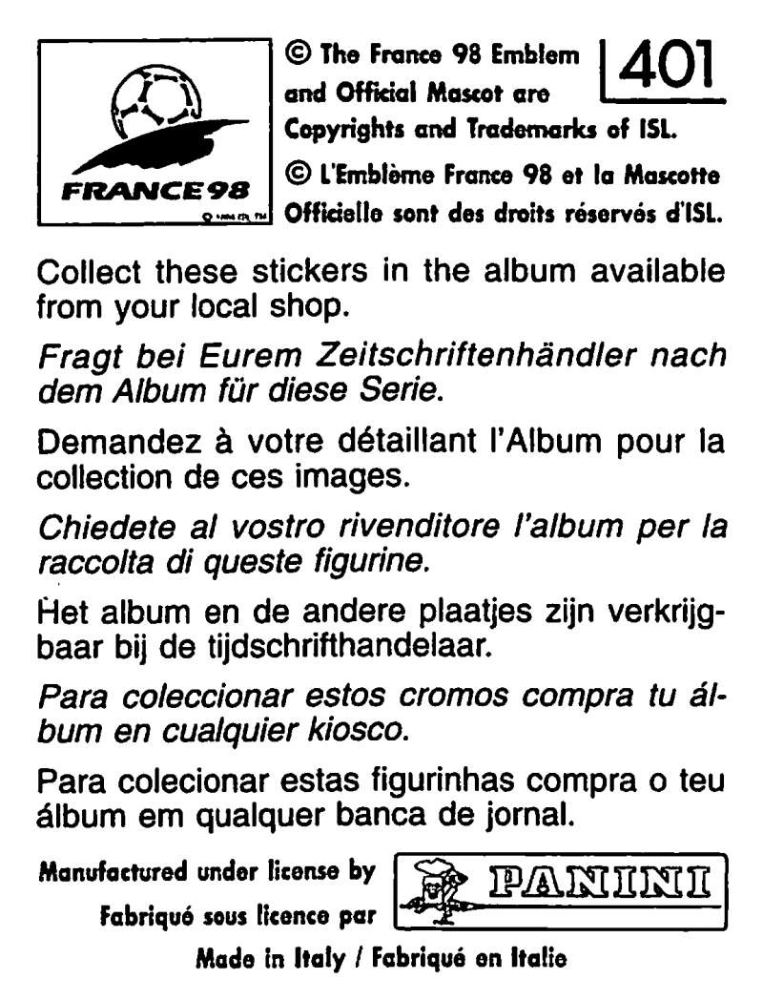

  

  

    

    

    

    

    <svg class="foil-facets" viewBox="0 0 512 512" preserveAspectRatio="none" aria-hidden="true" focusable="false"></svg>
    
    

    

    

    

      
      33
    

    

  

  

  

    Tap card to enable motion
  

  

    Move to catch the light · Click to turn over · Arrow keys tilt · Escape resets.
    Tap to turn over · Drag sideways to catch the light · Swipe vertically to scroll.
    Reduced motion is on. Use Enter or Space to turn over on desktop.
  

  

    <button class="action-button motion-toggle" type="button">Enable phone motion</button>
    <button class="action-button motion-recalibrate" type="button" hidden>Recalibrate motion</button>
  

